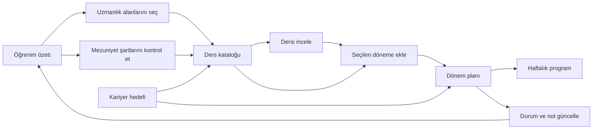

# KIT Planım — kullanıcı yolculuğu

## Amaç

Öğrencinin dört sorusuna sırayla yanıt vermek: Nerede duruyorum? Hangi dersi seçmeliyim? Hangi dönemde almalıyım? Haftam nasıl görünüyor?

## Sayfaların görevleri

- **Öğrenim özeti:** Uzmanlık seçimi, mevcut dönem, kredi durumu; ardından ayrıntılı mezuniyet denetimi. Alan seçimi zorunlu bir giriş kapısı değildir.
- **Ders kataloğu:** Önce arama, ardından hedef dönem ve sayılacak alan, sonra tür filtreleri. Ders eklenince sonuç bildirilir ve plana bağlantı verilir. Filtreleri sıfırlamak hedef dönemi değiştirmez.
- **Dönem planı:** Önce mevcut ve gelecek dönemler; geçmişte saydırılan dersler en sonda. Ders ayrıntısında dönem, durum ve not değiştirilebilir.
- **Haftalık program:** Mevcut dönemin ders saatleri, çakışmalar, takvim dışa aktarımı ve plana dönüş.
- **Kariyer:** Meslek → işveren türü → ders önerileri. Telefonda meslek seçici, masaüstünde karşılaştırmalı liste kullanılır.
- **Ayarlar:** Görünüm → yerel yedek → isteğe bağlı senkronizasyon → veri kaynağı.

## Tasarım kararları

İkinci tasarım, eski kenar menüyü tamamen kaldırır. Masaüstünde üst navigasyon, mobilde dört ana bölüm ve diğer sayfalara erişim sunan alt navigasyon kullanılır. Başlık, mevcut bölüm, dil ve tema tek uygulama kabuğunda birleşir.

Yeni görsel sistem: açık kâğıt yüzey, koyu mürekkep metin, mavi eylemler ve ayrı bir koyu kredi paneli. Ana çalışma alanları kutusuzdur; kredi bilgisi ve kariyere geçiş sınırlı yüzeylerle ayrılır. Koyu tema aynı hiyerarşiyi kullanır.

- Ana sayfa mevcut dönemi öne çıkarır. Boş planda katalog başlangıç eylemi, dolu planda ders listesi ve haftalık programa geçiş görünür.
- Kredi panelindeki 120 hücre gerçek kredi durumuna bağlıdır. Geçilen, planlanan, boş kalan ve tez kredileri farklı gösterilir.
- Mezuniyet denetimi açılabilir bir bölümdür; planı bulunan kullanıcıda açık başlar.
- Masaüstü katalogda filtreler solda, arama ve sonuçlar sağdadır. Mobilde arama önce gelir; filtreler açılır. Sıralama öneri, ders adı veya kredi miktarına göre yapılabilir.
- Dönem planı kart sütunları yerine dikey zaman çizelgesidir. Her dönemde yük göstergesi, ders listesi ve ekleme eylemi birlikte durur.
- Haftalık program masaüstünde tablo, telefonda günlük listeyle açılır. Kullanıcı iki görünüm arasında geçebilir. Her iki görünüm aynı veriyi ve çakışma bilgisini kullanır.
- Ayarlarda bölüm başlıkları ve denetimler masaüstünde iki kolonlu bir düzen oluşturur. İçe aktarma klavyeyle çalışır.

Üst navigasyon, eski menüye alışan kullanıcıların konumları yeniden öğrenmesini gerektirir; karşılığında katalog ve dönemlere daha fazla yatay alan bırakır. Dikey dönem planı karşılaştırmayı kolaylaştırır, uzun planlarda kaydırmayı artırır. Açılır filtreler mobilde bir ek dokunuş gerektirir, arama sonuçlarını ilk ekrana taşır.

## Uygulama sınırları

Notlar, kredi hesaplamaları, kayıtlı kullanıcı verisi, senkronizasyon ve eski bağlantı yönlendirmeleri mevcut uygulama mantığını kullanır. Örnek veya uydurma ders verisi eklenmez. Üretim sitesine yayınlama bu değişikliğin parçası değildir.

## Doğrulama

Üretim derlemesi ve 194 otomatik test. Tarayıcıda alan seçimi → ders arama → ekleme → dönem planı → ders ayrıntısı → haftalık program akışı; 390, 768, 1024, 1440 ve 1728 piksel genişliklerinde ana ekranlar; Türkçe, İngilizce ve koyu tema kontrolü.

## Kariyer sayfası

Görsel yaklaşım: mevcut kâğıt tonları üzerinde koyu bir meslek özeti, açık karşılaştırma alanı ve çizgilerle ayrılmış beceri/dönem listeleri.

Akış: çalışma ortamı ve meslek seçimi → geçilen derslerle mevcut planın katkısını karşılaştırma → önem sırasına göre beceri açığı → dönemlik önerileri inceleme → planı uygulama. Maaş, mülakat ve yöntem bilgileri isteğe bağlı açılır. Hedef kaydetmek ve ders planını uygulamak ayrı eylemlerdir.

Etkileşim: masaüstünde sabit kalan meslek listesi, seçili mesleğin vurgulanması ve bölüme kaydıran kısa yollar. Hareket azaltma tercihi kaydırmada korunur. Mobilde meslek listesi yerini etiketli seçiciye bırakır. Plan uygulandıktan sonra yeniden hesaplanan öneriler olsa da başarı mesajı görünür.

## Kariyer karar akışı

Meslek keşfi plan üretmez ve kayıtlı dersleri değiştirmez. En fazla üç açık beceri, ağırlık × kalan açık ile sıralanır; tüm beceriler açılır bir referans listesinde bulunur. Ders önerileri açık bir hazırlama eylemiyle üretilir. Varsayılan mod mevcut planı korur; yeniden kurma kullanıcı seçimidir. Taslak, taşınacak ders sayısını da gösterir. Yeniden kurmada tekrar seçilen dersin uygun olan mevcut dönemi korunur.

Uygulama sonrası taslak yerini tamamlanma ekranına ve dönem planı bağlantısına bırakır; tekrar hesaplanan öneriler kendiliğinden sunulmaz. Yeni meslek/çalışma ortamı seçimi yeni bir taslak başlangıcı açar. Doğrulama: 196 test, üretim derlemesi, beş ekran genişliği ve gerçek tarayıcıda hazırlama → alan seçimi → uygulama → dönem planı akışı.

## Tek seçim: çalışma ortamı

Kariyer sayfasında meslek seçimi kaldırıldı. Tek giriş çalışma ortamıdır; öneri motoruna gizli bir meslek atanmaz. Ortamın 1’den yüksek çarpanla vurguladığı beceriler, eşit taban ağırlık ve ortak 6 puan hedefiyle kullanılır; ortam çarpanları ağırlıkları farklılaştırır. Vurgu verisi olmayan ortamlar tüm becerilerle genel profile döner. Bu gösterge ortam becerilerine hazırlıktır, meslek uzmanlığı ölçümü değildir.

Yeni hedefler `role: environment` ile mevcut depolama şemasını kullanır. Eski rol/ortam hedefleri ve bağlantılar aynı ortamı açmaya devam eder. Özet ekranında hedef yalnızca ortam adıyla gösterilir. 197 test ve beş genişlikte tarayıcı doğrulaması tamamlandı.

## Baştan kurma kapsamı

“Bu ortama göre baştan kur” mevcut dönem dahil tüm planlı dersleri yeniden değerlendirir. Yalnızca geçilmiş dersler ve kullanıcının açıkça koruduğu dersler sabittir. Önceden planlanmış derslere puan avantajı verilmez; uygun olanlar yeniden seçilebilir. Uygulama sırasında çıkarılan veya başka döneme taşınan dersler haftalık programdan da kaldırılır. Taslak düzenlemek kayıtlı programı değiştirmez. Güncel doğrulama: 199 test ve üretim derlemesi.
